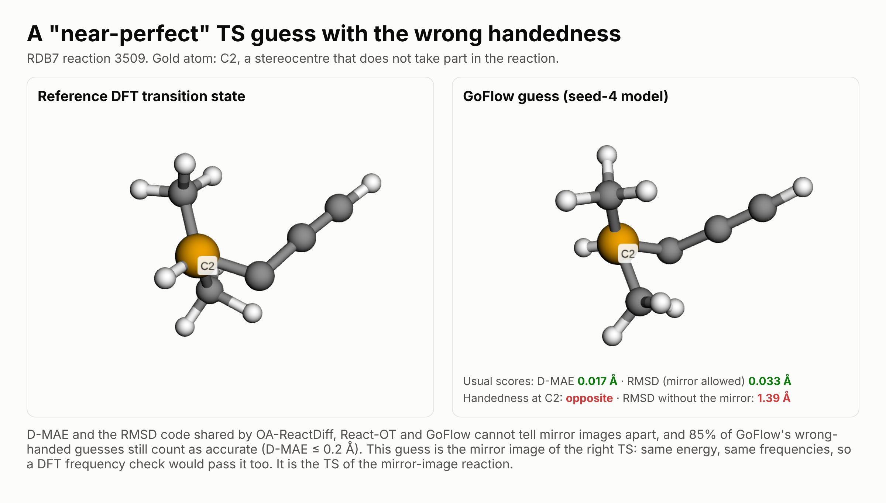
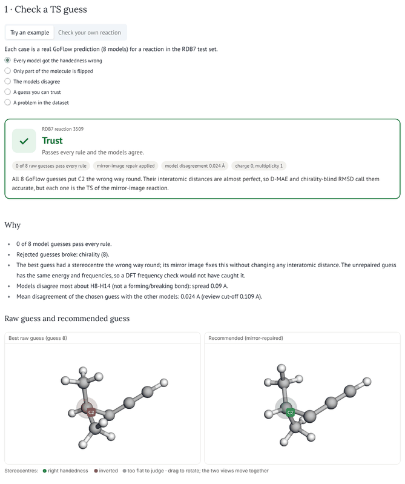

# TS Second Opinion

[](https://github.com/tammy357/ts-second-opinion/actions/workflows/tests.yml)


**Check, repair and triage machine-learned transition-state (TS) guesses before you spend DFT.**
Works with any TS generator and any elements, from a web app, the command line, Python, or an AI agent over MCP.

> **Open Scientific Intelligence (OSI) Hackathon 2026** · solo entry · sponsor tracks: marimo, Valency MCP Bond<br>
> **[▶ Live app](https://tammy357.github.io/ts-second-opinion/app/)** (runs in your browser, nothing to install) ·
> **[Video (4 min)](https://youtu.be/zaH6y7H471k)** · [Showcase page](https://tammy357.github.io/ts-second-opinion/) ·
> [Detailed results](docs/RESULTS.md)

## In 60 seconds

- **The problem.** About **1 in 6** GoFlow transition-state guesses has a stereocentre the wrong way round. Most are exact
  mirror images, so they pass D-MAE, mirror-allowed RMSD and **even a DFT frequency check**. It is not only GoFlow: an
  independent 2026 study sees the same blind spot in MolGen and TSDiff.
- **What it does.** Chemists write rules in plain English; **Claude turns each into code, kept only if it passes 9,540
  real DFT transition states**. The rules check every guess, mirror-repair whole mirror images, and give a verdict
  (✓ trust, ! check with DFT, ✕ re-generate) with a **stated error rate** for what to trust (conformal selection).
- **What it found.** Catches **93%** of wrong-handed guesses (0.2% false alarms); wrong-handed answers **17.7% → 2.3%**;
  **80%** of reactions trusted at a guaranteed 5% error rate; **new GFN2-xTB optimisations** confirm the verdicts
  (right TS reached for **77% / 60% / 0%** of ✓ / ! / ✕ guesses).
- **Also new.** A data audit (51 RDB7 entries contradict their own SMILES), a mirror test for any TS metric, a
  stereo-aware leaderboard, and panels where anyone can drop in their own reactions, test sets and datasets.
- **Limits.** No new DFT (GFN2-xTB instead); one dataset, RDB7 (tested on out-of-distribution splits); geometry errors are
  flagged for DFT, not fixed.



## Why it matters

Models such as [GoFlow](https://github.com/heid-lab/goflow) predict a TS in milliseconds instead of hours of DFT, but they
cannot tell you when they are wrong. On the RDB7 benchmark, **about one in six GoFlow guesses has a stereocentre the wrong
way round**. Most are exact mirror images of the right TS, so they pass distance-based scores, chirality-blind RMSD and
even a DFT frequency check: they are transition states of the mirror-image reaction.
[FK-Flow](https://arxiv.org/abs/2509.01543) (from the GoFlow group) first measured these errors and fixed them by steering
GoFlow during generation. TS Second Opinion works afterwards instead, on any generator's output, and also tells you which
guesses to trust, with a statistical guarantee.
It is not only GoFlow: on another dataset (Transition1x), an independent 2026 study
([ReCurveflow](https://arxiv.org/abs/2608.20869)) found that MolGen, GoFlow and TSDiff all lose 0.15–0.35 Å of
RMSD once mirror images are no longer allowed.

| On 1,194 held-out RDB7 reactions (8 GoFlow models) | |
|---|---|
| Wrong-handed guesses caught by two LLM-written rules | **93%** (0.2% false alarms) |
| Final answers with the wrong handedness, before → after checking and mirror repair | **17.7% → 2.3%** |
| Geometry errors among guesses marked "trust" vs those sent to DFT | **4.4% vs 40%** |
| Reactions you can trust at a guaranteed 5% average geometry-error rate (conformal selection) | **80%** |
| "Success" (D-MAE ≤ 0.2 Å) that is also correctly handed: GoFlow → with TS Second Opinion | **71% → 86.5%** |
| **New calculations** (GFN2-xTB TS optimisation): guesses that optimise to the reference TS, ✓ trust / ! check / ✕ re-generate | **77% / 60% / 0%** |

The rules repair handedness; they do not fix geometry errors (14.1% → 11.7%), which are flagged for DFT instead (a quick
xTB optimisation rescued only 1 of 13 flagged geometries). On reaction types never seen in training (RDB7's reaction-core
split) and on the barrier split, the rules still catch 90% and 89% of wrong-handed guesses at 0.1% false alarms.
New GFN2-xTB transition-state optimisations (not DFT) also show that an unrepaired mirror image optimises to a saddle point
with the same energy and imaginary frequency as the right TS, so a frequency check passes it: 34 of 40 reactions, and it
kept the wrong handedness in all 40.
Full results, caveats and every number's source: **[docs/RESULTS.md](docs/RESULTS.md)**.

### How it differs from what exists

| | Sees a wrong-handed TS? | Works on any generator's existing output? | Repairs it? | Says which guesses to trust, at a stated error rate? | Audits datasets and metrics? |
|---|---|---|---|---|---|
| Usual scores (D-MAE, RMSD with the mirror allowed) | ✕ | ✓ | ✕ | ✕ | ✕ |
| DFT frequency check | ✕ (a mirror image passes) | ✓ | ✕ | ✕ | ✕ |
| [FK-Flow](https://arxiv.org/abs/2509.01543): steers GoFlow while it generates | ✓ | ✕ (inside one model) | prevents | — | — |
| [RitS](https://doi.org/10.26434/chemrxiv.15001681/v1): stereo-aware generator | ✓ | ✕ (its own model) | prevents | — | — |
| **TS Second Opinion** | ✓ | ✓ | ✓ (whole mirror images) | ✓ (conformal selection) | ✓ (`tsso audit`, mirror test) |

The approaches are complementary: a stereo-aware generator makes fewer errors, and TS Second Opinion catches what any
generator still gets wrong, before DFT is spent.

### Who can use it

- **Anyone running ML transition-state models** (catalysis, combustion and atmospheric chemistry, process chemistry,
  reaction-network exploration): check, repair and decide what to send to DFT.
- **Anyone building or benchmarking a 3D generative model of chiral molecules**: the mirror test tells you in one click
  whether your metric can see handedness, and `tsso evaluate` scores a model with and without it.
- **Anyone building a reaction dataset**: drop it into the app's "Audit your own reaction dataset" panel (or
  `tsso.service.audit_files`) to find entries whose geometry contradicts their own SMILES.
- **Anyone validating scientific ML outputs with LLMs**: rules written in plain English, turned into code by an LLM, and
  kept only if they pass real reference data, is a pattern that carries over to other structure predictions.

## Quickstart

**Use it now, nothing to install:** **[open the live app](https://tammy357.github.io/ts-second-opinion/app/)**, or
[](https://molab.marimo.io/github/tammy357/ts-second-opinion/blob/main/apps/demo.py/wasm).
Both run the marimo app in your browser with WebAssembly (Pyodide), so uploaded files never leave your computer. In the
browser, a small pure-Python SMILES reader stands in for RDKit; it gives identical results on every RDB7 reaction
(`tests/test_smiles_lite.py`). To write new rules with Claude in the browser, paste your own Anthropic API key;
it is sent only to api.anthropic.com.

Run the same app on your machine without cloning (needs [uv](https://docs.astral.sh/uv/)):

```bash
uvx marimo run --sandbox https://raw.githubusercontent.com/tammy357/ts-second-opinion/main/apps/demo.py
```

To install the library, CLI and MCP server:

```bash
git clone https://github.com/tammy357/ts-second-opinion && cd ts-second-opinion
pip install -e .                    # Python 3.10+; no GPU and no PyTorch needed
marimo run apps/demo.py             # opens the app in your browser
```



**What you can do in the live app**

| Section | Try this |
|---|---|
| 1 · Check a TS guess | Five worked examples, or upload your own reaction: verdict, reasons, linked 3D views, report card, ORCA input, a data check, and Claude's explanation |
| 2 · Rule Studio | Replay a recorded run where Claude's first rule was rejected and rewritten, or write a new rule with Claude (your API key) |
| 3 · How much can you trust? | Pick an error rate; conformal selection says what share of reactions you can trust |
| 4 · Stereo-aware leaderboard | Every released GoFlow model, plus **score your own model** (or try 200 GoFlow predictions) |
| 5 · Beyond one model and one dataset | How it differs from prior work, the field-wide evidence, **the mirror test** for any metric, **audit your own dataset**, the new xTB results, an experimental repair for partly flipped guesses |
| 6 · Results | The figures |

The same from the command line, on the bundled example:

```bash
tsso check --smiles examples/rdb7_3509/reaction.smi \
           --reactant examples/rdb7_3509/reactant.xyz --product examples/rdb7_3509/product.xyz \
           examples/rdb7_3509/guesses.xyz --report report.html
```

```
Your reaction: ✓ TRUST  (trust: passes every rule and the models agree)
  recommended guess: model 8  (mirror-repaired)
  - 0 of 8 model guesses pass every rule.
  - Rejected guesses broke: chirality (8).
  - The best guess had a stereocentre the wrong way round; its mirror image fixes this without changing any
    interatomic distance. The unrepaired guess has the same energy and frequencies, so a DFT frequency check
    would not have caught it.
  ...
  report card: report.html
```

From Python:

```python
from tsso import second_opinion
result = second_opinion(smiles, "reactant.xyz", "product.xyz", ["model_a.xyz", "model_b.xyz"], report="report.html")
print(result["verdict"], result["reasons"])
```

From an AI agent: run `claude` (Claude Code) in this folder and approve the `ts-second-opinion` MCP server, then try
`/second-opinion 3509` or `/new-rule "A transferred hydrogen sits roughly on the line between donor and acceptor."`.
Any MCP client can use the tools (`tsso mcp`).

## Use it on your own reaction

You need an **atom-mapped reaction SMILES** with every atom mapped, hydrogens included (charge and multiplicity are read
from it), the **reactant and product** as `.xyz`, and **one or more TS guesses** from any generator (several files or one
multi-frame `.xyz`). Several guesses (models, seeds or samples) add the model-disagreement signal. Atoms are listed by
atom-map number by default; add `--order smiles` if your files follow the SMILES order. Add `--write-xyz best.xyz
--orca best.inp` for the recommended geometry and an ORCA OptTS + Freq input. See `examples/` for ready-made files.

To score a generator's test-set predictions with and without handedness (also in the live app, under the leaderboard):

```bash
tsso evaluate predictions.xyz references.xyz reactions.smi      # multi-frame xyz, one frame per reaction
```

Handedness stays at 82–85% correct for every released GoFlow model size (64 to 512 hidden features), so a bigger model
does not fix it. The full leaderboard is in [docs/RESULTS.md](docs/RESULTS.md#full-stereo-aware-leaderboard); to add a
model, see [CONTRIBUTING.md](CONTRIBUTING.md).

**Mirror test for metrics** (`tsso.mirror_test`, and in the app): scores each of 447 reference TSs against its own
mirror image. D-MAE and RMSD with the mirror allowed call all 447 pairs identical; RMSD with proper rotations sees
every one. Paste your own metric to test it.

**Data audit** (`tsso audit`): in 51 of the 10,734 RDB7 reactions used here (0.5%), the product geometry's bonding
contradicts the product SMILES, for example a hydrogen sitting on a different carbon. The list is in
[`results/rdb7_audit.csv`](results/rdb7_audit.csv); every uploaded reaction gets the same check.

**Benchmark data** ([`benchmark/`](benchmark/README.md)): handedness labels for all 9,552 GoFlow guesses on the 1,194 RDB7
test reactions, plus a mirror-image unit test for TS metrics (447 mirrored reference TSs that a handedness-blind metric
scores as perfect).

## How it works

```
plain-English rule ──► Claude writes check(rxn, xyz) ──► gate: accept ≥ 99% of 9,540 real DFT TSs, never crash,
        ▲                                                   and catch ≥ 1% of mirrored or distorted TSs
        └──────── feedback with the failing examples ◄──── (else rewrite)

TS guesses ──► run every accepted check ──► consensus among passing guesses
           ──► if a stereo rule still fails, try the mirror image (identical distances, opposite handedness)
           ──► verdict ✓ / ! / ✕ (! = most-disputed 20% by model disagreement) ──► report card + ORCA input
           ──► optional: certified trust, calibrated on reactions with known answers
```

### How LLMs are used

- **Rules → tested code.** A chemist writes a rule as one sentence; Claude writes the Python; the gate tests it on 9,540
  real DFT transition states and sends the failures back until it passes. Checks run in a sandbox that hides the
  reference TS. The app's Rule Studio replays real runs where the first attempt was rejected.
- **Agents.** An MCP server and two Claude Code commands let an agent triage reactions, certify, evaluate generators and
  write new rules (`/new-rule`, `/second-opinion`). With **Valency MCP Bond** connected, `/second-opinion` adds related
  reading from ChemRxiv, arXiv and PubMed to each report; see the recorded run in
  [results/second_opinion_report.md](results/second_opinion_report.md). Valency also found the closest prior work:
  [RitS](https://doi.org/10.26434/chemrxiv.15001681/v1) (2026) makes TS *generation* stereo-aware; TS Second Opinion
  checks and repairs any generator's output afterwards.
- **Explanations.** Claude explains each verdict in plain English, from the facts the tool computed.
- **Honest comparison.** Claude's checks perform about the same as the same rules written directly as code. The value of
  the LLM is access (no coding needed); what makes any check trustworthy is the gate. Claude also proposed 8 rules of its
  own: all passed the gate, none helped on held-out data, so none were kept.

## OSI judging criteria at a glance

| Criterion | |
|---|---|
| **Potential for impact** | Clear users, usable today in a browser with their own data: chemists deciding which ML transition states to send to DFT (check, repair, trust at a stated error rate); TS-model developers, who get a stereo-aware score in one click; and dataset curators (audit your own dataset). New GFN2-xTB optimisations confirm the verdicts: the right TS is reached for 77% of trusted guesses and 0% of re-generate ones. |
| **Innovativeness** | The obvious fixes are retraining or steering one model, or a DFT frequency check, which a mirror image passes. Instead, a model-agnostic second-opinion layer: chemists' rules in plain English become Claude-written code that must pass a data gate, a reflection repairs whole-mirror errors at no cost, and conformal selection states the error rate. |
| **Novelty** | Post-hoc handedness checking and repair for any generator (prior work, FK-Flow and RitS, acts inside one model); a stereo-aware leaderboard and a mirror test for any TS metric; an audit that found 51 RDB7 reactions whose product geometry contradicts its SMILES. Open avenues: other generators and datasets, DFT validation, and the gated rules as steering potentials during generation. |
| **Relevance** | A specific problem in chemistry: transition states gate kinetics, catalysis and reaction-network studies, and every wrong guess sent to DFT costs hours. |

## Reproduce every number

```bash
pip install -e ".[dev]"
python -m pytest -q tests                # 25 tests
python scripts/evaluate.py               # -> results/metrics.json
python scripts/triage_all.py 0.2         # verdicts for all 1,194 reactions -> results/triage.csv
python scripts/benchmark.py              # mirror blindness, handedness split, risk-coverage -> results/benchmark.json
python scripts/certify.py                # certified trust -> results/certify.json
python scripts/leaderboard.py            # stereo-aware leaderboard -> results/leaderboard.md
python scripts/ablation_authors.py       # Claude-written vs directly written checks -> results/ablation_authors.json
python scripts/build_benchmark.py        # benchmark/ data files
python scripts/audit_rdb7.py             # RDB7 data audit -> results/rdb7_audit.csv
python scripts/xtb_prospective.py mirror 40; python scripts/xtb_prospective.py verdicts 30   # new xTB TS optimisations
python scripts/build_site.py             # the static showcase in docs/ (GitHub Pages)
python scripts/build_wasm.py             # the in-browser app in docs/app/
```

Writing new rules needs the `claude` CLI or an `ANTHROPIC_API_KEY` (`pip install -e ".[api]"`). Data files are derived
from GoFlow's released predictions and RDB7; `scripts/export_data.py` and `scripts/build_reference_set.py` rebuild them
from a clone of the GoFlow repository.

## Limitations

- **Mostly retrospective.** No new DFT was run; "right" means close to RDB7's reference TS. New GFN2-xTB transition-state
  optimisations (106 reactions, `scripts/xtb_prospective.py`) confirm the mirror-image argument and the verdicts at a
  semi-empirical level; DFT would be the next step.
- **One dataset, one model family.** Small H/C/N/O molecules (RDB7) and GoFlow models, though tested on RDB7's
  out-of-distribution splits. `tsso check` accepts any elements, but the rules were gated on RDB7: test them on your own
  reference TSs with `tsso gate` first.
- **Mirror-image errors leave the barrier unchanged.** They matter whenever stereochemistry does; for barrier heights
  alone, use the geometry-only numbers.
- **Some choices were made after seeing test results**, and the guarantee is an average that assumes new reactions look
  like the calibration ones. Details: [docs/RESULTS.md](docs/RESULTS.md#limitations-in-detail).

## Credits and citation

GoFlow (Galustian, Mark, Karwounopoulos, Kovar & Heid, *Digital Discovery* 2025; MIT) supplied every model prediction
used here. RDB7 (Spiekermann, Pattanaik & Green, *Sci. Data* 2022) supplied the reference structures. FK-Flow (Mark,
Galustian, Kovar & Heid, 2025) first measured GoFlow's chirality errors. The idea grew out of a Q&A with Dr Esther Heid
(TU Wien) at the AIchemy webinar on 21 October 2026. Conformal selection follows Jin & Candès (*JMLR* 2023). The 3D viewer
is [3Dmol.js](https://3dmol.csb.pitt.edu/) (BSD-3). More related work: [docs/RESULTS.md](docs/RESULTS.md#related-work-in-detail).

If you use TS Second Opinion, please cite it ([CITATION.cff](CITATION.cff)) together with GoFlow and RDB7.
Contributions (new rules, new generators on the leaderboard) are welcome: [CONTRIBUTING.md](CONTRIBUTING.md).

```
apps/demo.py         the app (marimo)            tsso/          library, CLI (tsso) and MCP server
examples/            ready-to-run inputs         tsso/checks/   the six gated, Claude-written rules
scripts/             experiments and figures     results/       metrics, figures, leaderboard, agent transcripts
docs/RESULTS.md      detailed results            data/          GoFlow predictions + RDB7 references (gzipped JSON)
docs/index.html      the showcase page           benchmark/     stereo-aware labels and the mirror-image unit test
docs/app/            the in-browser app (WASM)   results/xtb_prospective_*.json   the new GFN2-xTB calculations
```

Code: MIT licence. Data files are derived from GoFlow (MIT) and RDB7; please cite both.
