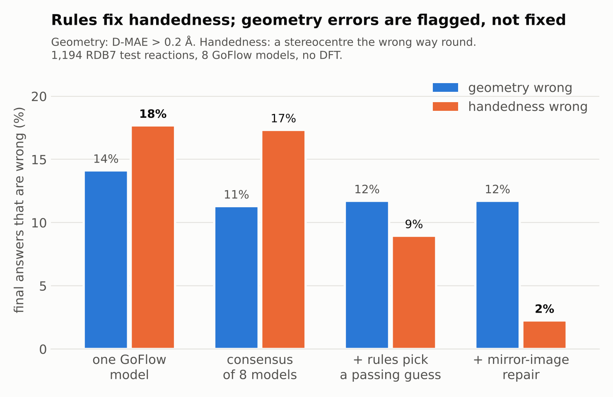
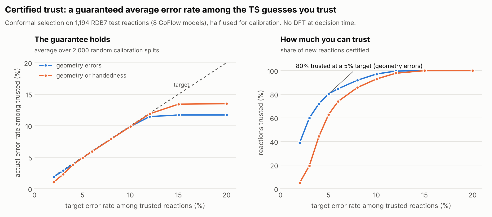
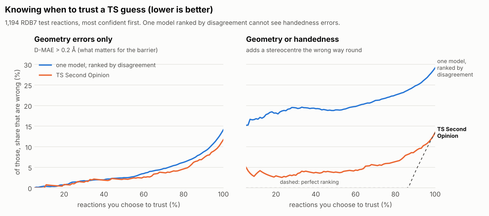

# Detailed results

Everything behind the numbers in the [README](../README.md). All results are retrospective: GoFlow's released predictions for the 1,194 RDB7 test reactions, with rules gated only on the 9,540 training reactions. Every number is reproduced by the scripts listed in the README.

## Results on RDB7




### What we found

Tested retrospectively on GoFlow's released predictions for the **1,194 RDB7 test reactions**
(8 GoFlow models trained with different seeds). Rules were written, tuned and gated only on the
**9,540 RDB7 training reactions**. We count two kinds of error against the reference DFT TS, because they
matter differently: **geometry** (interatomic-distance error, D-MAE, above 0.2 Å), which affects the barrier,
and **handedness** (a stereocentre the wrong way round), which usually leaves the energy unchanged but makes it
the transition state of a different reaction.

| | |
|---|---|
| **Handedness** | |
| GoFlow guesses with a stereocentre the wrong way round | **17.7%**, and 85% of them still count as accurate by D-MAE |
| …that are whole mirror images, with the same energy and frequencies as the right TS | **90%**; the other 10% flip only some stereocentres (a diastereomer, with a different energy) |
| …caught by two LLM-written stereo rules | **93%**, with 0.2% false alarms |
| Final answers with the wrong handedness: one model → after rules and mirror-image repair | **17.7% → 2.3%** |
| **Geometry** | |
| Final answers with a geometry error: one model → consensus of 8 → after the rules | 14.1% → 11.3% → 11.7% (the rules do not fix geometry) |
| Geometry errors among reactions marked trust / check with DFT / re-generate (80% / 20% / 0.5% of reactions) | **4.4% / 40% / 67%** |
| **Certified trust:** reactions trusted at a guaranteed 5% average geometry-error rate | **80%** (actual 4.9%, averaged over 2,000 calibration splits) |
| **Both kinds together** | |
| Final answers wrong in either way: one model → TS Second Opinion | 29% → 13%, with no DFT |

Two honest negatives:

- **Shape rules (clashes, bond lengths, flatness) rarely fire** on GoFlow's guesses (under 1.2% each)
  and add nothing beyond model disagreement for geometry errors (AUROC 0.86 alone, 0.85 with the rules). GoFlow's
  shapes are physically sensible; its geometry errors are subtle, and disagreement is the better signal for them.
- The planarity rule never fires on these small RDB7 molecules (at most 7 heavy atoms). It is kept
  because it passed the gate, but it does no work here.

### Benchmark finding: how far the usual TS metrics miss mirror images

This blind spot is known. FK-Flow (Mark, Galustian, Kovar & Heid, 2025) notes that "the chirality error mode cannot be seen in
the mean absolute error of the inter-atomic distances (DMAE)", reports GoFlow chirality errors of 9.0% (persistent) and 27.8%
(thresholded) by its definitions, and cuts them to 0.7% and 5.8% by Feynman–Kac steering during sampling, which needs the
model and a g-xTB potential. Our handedness measure is defined differently (every checked stereocentre against the reference
TS), so the numbers are not directly comparable. What we add: where the blind spot sits in shared evaluation code, how much it
inflates reported success, and that most of these errors would pass a DFT frequency check too.


The RMSD code shared by OA-ReactDiff, React-OT and GoFlow is called with `ignore_chirality=True`
(it takes the better of the guess and its mirror image), and D-MAE compares interatomic distances, which a
mirror image keeps exactly. So a TS with the wrong handedness can score as perfect:

| | |
|---|---|
| Mirror image of the reference TS, for the 447 test reactions with stereocentres | D-MAE **0.000 Å**, RMSD with mirror allowed **0.000 Å** (proper-rotation RMSD: median 1.50 Å) |
| Wrong-handed GoFlow guesses that would count as accurate (D-MAE ≤ 0.2 Å) | **85%** (median D-MAE 0.085 Å, vs 0.081 Å for right-handed guesses) |
| GoFlow "success rate": D-MAE ≤ 0.2 Å only → also requiring correct stereo | **85.9% → 70.8%** |

### Why handedness errors slip past distance scores and even a DFT frequency check

Energy-based checks miss these errors too. 90% of GoFlow's wrong-handed guesses (1,514 of 1,690) flip every
stereocentre, so the guess is the mirror image of a correctly handed one. Mirror images have identical energies,
forces and vibrational frequencies, so a DFT TS optimisation and frequency check treats the guess exactly as it
treats the right one: it finds a genuine saddle point with one imaginary mode, but for the mirror-image reaction. An IRC from
it leads to the mirror images of the intended reactant and product, so it is caught only if the endpoints are compared with
their stereochemistry. The barrier is right; the stereochemistry is not. That matters whenever stereochemistry
does (stereoselectivity, chiral catalysts or enzymes, stereo-labelled datasets, mechanisms). The other 10% flip only some
stereocentres. They correspond to a diastereomer, whose energy does differ, and mirroring cannot fix them, so they are sent
for re-generation. A rule that compares handedness with the reaction as written catches both cheaply, before any DFT is spent.

We suggest reporting stereo correctness alongside D-MAE and RMSD, and judging confidence estimates with
risk–coverage curves (how often the answers you choose to trust are wrong):



| Share of trusted answers that are wrong | trust 50% | trust 80% | trust all | AURC |
|---|---|---|---|---|
| Geometry errors only: one GoFlow model, ranked by its disagreement with the other 7 | 2.5% | 6.2% | 14.1% | 0.039 |
| Geometry errors only: TS Second Opinion (rules + repair + disagreement) | **2.2%** | **4.6%** | **11.7%** | **0.032** |
| Geometry or handedness: one GoFlow model, ranked by disagreement | 18.9% | 22.6% | 29.2% | 0.205 |
| Geometry or handedness: TS Second Opinion | **3.9%** | **6.4%** | **13.5%** | **0.051** |

For geometry alone, most of the ranking power comes from model disagreement. The large gap in the last two rows comes
from handedness errors, which a model's disagreement cannot see.

### Certified trust: a guaranteed error rate, not just a score

A verdict of "trust" is only useful if you know how often it is wrong. Conformal selection (Jin & Candès, *JMLR* 2023)
turns the triage into a guarantee. Calibrate on reactions whose answers you know (for example, from earlier DFT). For each new
reaction, compare its trust score (rules first, then model disagreement) with the calibration reactions that turned out
wrong, and trust the reactions picked by the Benjamini–Hochberg procedure. If new reactions are drawn like the calibration ones,
the expected share of trusted reactions that are wrong is at most the target, whatever the model or the sample size
(`tsso/certify.py`, `scripts/certify.py`, `tsso certify --target 0.05`, MCP tool `certify_trust`).

Tested by splitting the 1,194 test reactions at random into calibration and new halves 2,000 times:

| Target (average error rate among trusted reactions) | 3% | 5% | 10% |
|---|---|---|---|
| Geometry errors: reactions trusted / actual error rate | 60% / 2.9% | **80% / 4.9%** | 97% / 9.9% |
| Geometry or handedness: reactions trusted / actual error rate | 19% / 2.3% | 63% / 4.9% | 93% / 9.9% |

What the guarantee does and does not say:

- **It is an average.** In a single calibration draw the rate can be higher: for a 5% target, 95% of draws stayed at or below 7.4%.
- **The correction matters most at strict targets.** A naive cut-off (trust everything scoring above the point where
  the calibration error rate is under target) does about as well on average here, but it overshoots at strict targets
  (3% target → 4.1% actual, geometry or handedness) and comes with no guarantee.
- **It assumes nothing changed.** When we certified guesses from a different ensemble (5 GoFlow runs of four model sizes) using the
  8-seed calibration, the error rate stayed under target (2.5% at a 5% target) but only 53% of reactions were trusted;
  recalibrating on that ensemble restored 74% at 4.8%. A change in the other direction could break the guarantee, so
  recalibrate whenever the generator, the data or the rules change.
- **The trust score was designed with this test set in view** (see Limitations), which the theory does not allow; the
  repeated random splits are the practical check.

We did not find prior work applying conformal selection to machine-learned TS guesses, but our search was brief; conformal
methods have been used for generative molecular design ([ConfHit](https://arxiv.org/abs/2603.07371),
[SCoRE](https://arxiv.org/abs/2603.24704)).

### Is it only GoFlow?

No. On Transition1x, a different dataset, the ReCurveflow study (Baek, Gim & Kang, arXiv:2608.20869, 2026; their Table 1,
native split) reports reflection-invariant RMSD against chirality-preserving RMSD for eight generators. Three lose
0.15–0.35 Å once mirror images are not allowed: GoFlow 0.33 → 0.61 Å, MolGen 0.27 → 0.62 Å and TSDiff 0.41 → 0.56 Å.
Their headline metric is still the reflection-invariant one. Neither that study nor the 2026 robustness study of React-OT
(Darouich et al., arXiv:2601.16469) checks, repairs or filters TS guesses for handedness after generation.

### Can partial flips be repaired?

Mostly not usefully. We tried a local "umbrella" inversion: reflect the wrong stereocentre and its smallest terminal
branch (usually a hydrogen) through the plane of its other neighbours, which inverts that centre and keeps every bond to
it exactly. Applied to single GoFlow guesses (9,552), it fixed the handedness of 40 of the 49 guesses it could edit and
broke none, cutting wrong-handed single guesses from 3.3% to 2.8%. But 41 of the 49 already had a geometry error
(D-MAE > 0.2 Å), and their mean D-MAE rose from 0.26 to 0.33 Å. In the 8-model pipeline only 5 final answers had a
detectable wrong centre. Partly flipped guesses are usually broken in other ways too, so the verdict stays "re-generate",
and the inversion is not part of the pipeline. The app offers it as an experimental button on partly flipped
guesses (`tsso/stereo_edit.py`), with the rules checking the result: on example 5877 the inverted centre comes out
right but the edit creates a clash, so the verdict stays "re-generate".

### Data audit: where RDB7's SMILES and geometries disagree

The checks that test TS guesses assume the atom-mapped SMILES and the reactant and product geometries describe the same
molecules. `tsso audit` tests that assumption directly: a structure is flagged when two atoms sit at single-bond distance
(below 1.10x the sum of their covalent radii) but the SMILES does not bond them, or when the SMILES bonds two atoms that
are more than 1.60x apart. In **51 of the 10,734 RDB7 reactions** used here (10 test, 41 training; 0.5%), and only ever in
the **product** geometry, the two disagree: for example, in reaction 6295 the SMILES puts H11 on C2, but in the
geometry it sits 1.08 A from C3 and 2.1 A from C2. Reaction 1093, one of the app's worked examples, is flagged (an N5-O6
bond at 1.45 A that the SMILES says is broken). The thresholds are deliberately conservative, so borderline cases (such
as a 1.69 A C-C contact) are not counted. The full list is in `results/rdb7_audit.csv`
(`python scripts/audit_rdb7.py`). The same check runs on every uploaded reaction and shows a warning when it fires. We
do not know whether these entries reflect the SMILES or the geometry being wrong; either way, a model trained or scored
on them sees an inconsistent target.

### Does it generalise?

All of these use predictions the GoFlow authors released; nothing was retrained.

| Setting | Stereo errors | Caught by the stereo rules | Wrong answers (geometry or handedness) before → after |
|---|---|---|---|
| 5 GoFlow runs of four model sizes (64–512 hidden features; random split), used as an ensemble | 15–18% per model | 92% (0.2% false alarms) | 31% → 14% (AUROC 0.70 → 0.91) |
| 1 GoFlow model, reaction-core split (harder) | 16% | 91% (0.1% false alarms) | 33% → 22% (rules + mirror only, no ensemble) |
| 1 GoFlow model, barrier-height split (harder) | 17% | 89% (0.1% false alarms) | 36% → 27% (rules + mirror only, no ensemble) |
| No ML: midpoint of aligned reactant and product | 1% | – | rules flag 43% of guesses; 76% of flagged vs 38% of unflagged are wrong |

So the stereo failure is not one unlucky model: every released GoFlow model size and split has it at about the same rate.
Caveat: the rules were gated on the random-split training set, which contains about 80% of the test reactions of
the two other splits. The gate only checks that a rule accepts real TSs, and the stereo rules have no tuned thresholds
beyond small signed-volume cut-offs, but these split results are not fully independent of the gate.

### Does it matter who writes the check?

For the same six rules we compared Claude's checks, written from the plain-English sentence, with drafts written directly
as Python during development (by the author with an AI coding assistant, before the rule-to-code pipeline existed).
Both versions passed the gate, and they perform about the same on GoFlow's test guesses (`scripts/ablation_authors.py`):

| Final answers after triage | Claude-authored checks | Directly written drafts |
|---|---|---|
| Geometry wrong | 11.7% | 11.6% |
| Handedness wrong | 2.3% | 1.4% |
| Product-stereo check: real TSs accepted / handedness errors caught | 99.8% / 87% | 99.1% / 93% |

So Claude's checks are not better than checks written directly as code. What the LLM adds is access: a chemist who does
not write Python gets a tested check from one sentence. What makes any check trustworthy, however it was written, is the gate.

### What did not work, and why that matters

- **Shape rules** (see above) rarely fire on GoFlow guesses and add nothing for geometry errors.
- **Claude proposing its own rules.** Asked for 8 new rules (`scripts/discover_rules.py`), Claude produced plausible ones
  (bond-angle ranges, torsions, near-linear hydrogen transfer, balanced progress of forming and breaking bonds). All 8 passed the gate, some after rewrites,
  but none improved triage on the held-out half of the test reactions, so none were added. The gate plus held-out
  selection is what stops plausible-sounding but useless rules from creeping in.
- **Cheap physics single points.** GFN2-xTB energies of the reference TSs track the DFT barriers well (Spearman 0.88),
  but on raw guesses the xTB "barrier" and RMS gradient flag bad geometries poorly (AUROC 0.63 and 0.65), adding them to
  disagreement makes ranking worse (0.79–0.81 vs 0.86), and choosing the lowest-energy guess is worse than the consensus.
  In a quick 5-reaction trial, xTB TS optimisation (Sella) moved 4 guesses further from the DFT TS, so xTB is not a good
  stand-in for the DFT check here (`scripts/xtb_check.py`).

## Full stereo-aware leaderboard

| Method | Model size | Test set | D-MAE (Å) | RMSD, mirror allowed (Å) | Success (D-MAE ≤ 0.2 Å) | Correct handedness | **Success with correct handedness** |
|---|---|---|---|---|---|---|---|
| GoFlow, 8 seeds (mean ± s.d.) | 256 | random split (1,194) | 0.110 ± 0.003 | 0.356 ± 0.006 | 85.9% ± 0.5% | 82.3% ± 0.7% | **70.8% ± 0.6%** |
| GoFlow, size run 1 | 64 | random split (1,194) | 0.163 | 0.494 | 72.2% | 85.0% | **61.9%** |
| GoFlow, size run 2 | 128 | random split (1,194) | 0.124 | 0.403 | 82.5% | 83.8% | **69.4%** |
| GoFlow, size run 3 | 256 | random split (1,194) | 0.102 | 0.335 | 88.4% | 82.4% | **72.9%** |
| GoFlow, size run 4 | 256 | random split (1,194) | 0.105 | 0.343 | 86.1% | 83.1% | **71.3%** |
| GoFlow, size run 5 | 512 | random split (1,194) | 0.114 | 0.357 | 85.0% | 83.1% | **70.8%** |
| GoFlow, 1 model | 256 | reaction-core split (1,106) | 0.138 | 0.425 | 79.2% | 83.8% | **67.3%** |
| GoFlow + TS Second Opinion (rules + mirror repair, no ensemble) | 256 | reaction-core split (1,106) | 0.138 | 0.425 | 79.2% | 97.6% | **77.8%** |
| GoFlow, 1 model | 256 | barrier-height split (1,192) | 0.149 | 0.432 | 74.7% | 83.5% | **64.0%** |
| GoFlow + TS Second Opinion (rules + mirror repair, no ensemble) | 256 | barrier-height split (1,192) | 0.149 | 0.432 | 74.7% | 96.4% | **73.2%** |
| No ML: midpoint of aligned reactant and product | – | random split (1,194) | 0.234 | 0.488 | 45.6% | 98.8% | **45.5%** |
| GoFlow 8 seeds + TS Second Opinion (final answer) | 256 | random split (1,194) | 0.099 | 0.314 | 88.3% | 97.7% | **86.5%** |
| GoFlow 5 size runs + TS Second Opinion (final answer) | – | random split (1,194) | 0.104 | 0.327 | 87.7% | 97.7% | **86.1%** |

## How it works, in detail

```
plain-English rule ──► Claude writes check(rxn, xyz) ──► gate: accept ≥ 99% of 9,540 real TSs,
        ▲                                                   never crash, and catch ≥ 1% of
        └──────── feedback with failing examples ◄──────── mirrored or noisy TSs  (else rewrite)

8 GoFlow guesses ──► run every accepted check ──► consensus among passing guesses
                 ──► if a stereo rule still fails, try the mirror image (same distances)
                 ──► verdict:  ✓ trust  ·  ! check with DFT (top 20% model disagreement)  ·  ✕ re-generate
                 ──► ORCA TS-optimisation input for flagged reactions
                 ──► optional: certified trust, calibrated on reactions with known answers
```

- **Rules → code** (`tsso/author.py`, `tsso/llm.py`): Claude via the Claude Code CLI (`claude -p`, works
  with a Pro/Max plan) or the Anthropic API. Checks only see what is known before any quantum chemistry:
  reactant and product geometries, bonds and stereo tags. The reference TS and the model predictions are
  hidden, and code with imports, file access or double-underscore names is rejected (`tsso/sandbox.py`).
- **The gate** catches both failure modes of LLM-written code: too strict (rejects real TSs) and too loose
  (never fires). In the final run, 5 of 6 rules passed first time and `planarity` needed two rewrites
  (in an earlier run, `reacting_bonds` also needed one). Logs: `results/authoring_log*.jsonl`.
- **Mirror-image repair**: if every guess has a stereocentre the wrong way round, the mirror image keeps
  every interatomic distance (so geometric accuracy is unchanged) and flips handedness. It is applied only if
  the mirrored guess then passes every rule; it was applied to 80 reactions.
- **Disagreement** is the mean D-MAE between the chosen guess and the other 7 models. The review cut-off is a
  budget (the most disputed 20% of reactions), set from the disagreement values alone, never from reference answers.

## The agent layer in detail

TS Second Opinion is also an MCP server, so Claude Code, Claude Desktop or any MCP client can use it as tools:
`triage_structures` (your own reaction and guesses, from any generator), `evaluate_predictions`, `certify_trust`,
`list_reactions`, `triage_reaction`, `list_rules`, `get_rule_source`, `gate_check`, `save_rule`, `write_orca_input` and
`benchmark_summary`.

```bash
pip install -e .            # installs the `tsso` command
claude                      # in this folder: .mcp.json starts `tsso mcp` automatically
> /new-rule "A hydrogen that is being transferred sits roughly on the line between donor and acceptor."
> /second-opinion 3509 1093 239
```

In `/new-rule` the agent writes the check, calls `gate_check`, reads which real transition states it wrongly rejected,
revises and re-tests, then saves it. In our recorded run (`results/agent_new_rule_transcript.md`) the first version
rejected 36% of real TSs (it forgot that 1,2- and 1,3-hydrogen shifts are bent); the second passed. The agent then
reported, honestly, that the rule never fires on GoFlow guesses and adds little. `/second-opinion` triages reactions,
explains each verdict, writes ORCA inputs for flagged ones, and, if the Valency MCP server is connected, cites related
ChemRxiv preprints as background reading (`results/agent_second_opinion_transcript.md`; Valency was not connected in
that recorded run; it worked when we re-ran the command with Valency connected). Reaction 3509 is a good example: all eight GoFlow models put C2 the wrong way round, and the
mirror repair gives a guess with D-MAE 0.019 Å and correct stereochemistry.

The same functions are available as a CLI: `tsso check`, `tsso evaluate`, `tsso certify --target 0.05`,
`tsso triage 3509 --score`, `tsso list --verdict red`, `tsso rules`, `tsso gate "<rule>" check.py`, `tsso author "<rule>"`,
`tsso orca 3509` and `tsso summary` (add `--json` to any of them). An agent like [TSAgent](https://arxiv.org/abs/2605.14154), which runs DFT TS searches
but has no check on ML guesses beforehand and no stereo check, could call these tools before spending DFT.

## Where foundation models fit

- **Language models** write and revise the checks and explain verdicts; they do not judge geometry directly.
- **Interatomic-potential foundation models** are the natural next stage after triage: a 2026 benchmark found
  MACE-OMol25 locating TSs with a 96.6% success rate using fewer than four DFT gradients per reaction
  ([arXiv:2604.00405](https://arxiv.org/abs/2604.00405)). A pipeline would be: generator → TS Second Opinion → MLIP refinement
  (MACE-OMol25 or UMA) for amber cases → DFT only where needed. We did not run an MLIP here (it needs PyTorch, which was not
  available in our build environment).
- **Steering**: because Feynman-Kac steering accepts non-differentiable potentials, the same gated checks could steer
  GoFlow during generation once model weights are available, instead of filtering afterwards.

## Limitations in detail

- **Retrospective.** No new DFT was run. "Right" means close to RDB7's reference TS geometry, not that a
  TS optimisation from the guess converges. The statements above about what DFT would do with a mirror-image guess follow
  from symmetry (an achiral Hamiltonian gives mirror images identical energies), not from new calculations.
- **Whether a handedness error counts as wrong depends on what you need.** For a barrier height alone, a whole mirror image
  gives the right number; the geometry-only rows are the fair comparison for that use.
- **GoFlow's released predictions were aligned to the reference before saving.** GoFlow's evaluation code rotates each
  sample onto the reference TS and relabels symmetry-equivalent atoms (for example, the hydrogens of a methyl group) to
  match it, then saves the sample closest to the median. Our disagreement scores inherit this relabelling, which may make
  models look slightly more consistent than they would without a reference. Structures you triage yourself are not relabelled.
- **One dataset, one model family.** Small gas-phase molecules (H, C, N, O; at most 7 heavy atoms), GoFlow runs of
  four model sizes and two extra splits, plus a naive interpolation baseline. Other generators (React-OT, TsDiff) were not
  run. `tsso check` accepts any elements, but the rules were only gated on RDB7: test them on reference TSs from your own
  chemistry with `tsso gate` before relying on them there.
- **Eight models cost eight trainings.** Comparing against only 3 other models gives similar disagreement quality
  (AUROC 0.84 vs 0.86 for geometry errors), but a single model with many samples was not tested because
  the released files keep only one sample per model.
- **Some choices were made after looking at test results.** The product-stereocentre rule was added after we saw
  stereo errors at product stereocentres in the test predictions, and "wrong" uses a 0.2 Å threshold we chose
  (about twice GoFlow's average error). Every rule's code and threshold were fixed using training references only.
- **Some RDB7 reference TSs have inconsistent chirality.** FK-Flow reports RDB7 entries whose TS chirality disagrees with
  the reactant and product, and some with impossible chirality. The gate tolerates up to 1% rejected reference TSs, which
  leaves room for such entries, but a correct rule could still look slightly worse because of them.
- **Rules written by an LLM can be wrong.** The gate tests them on real transition states, but it cannot prove a rule
  is chemically complete. Every check is plain Python in `tsso/checks/` for a chemist to read.
- One of the 6 reactions marked "re-generate" (RDB7 1093) looks like a dataset inconsistency rather than a model error:
  its atom-mapped SMILES says the N5–O6 bond breaks, but the reactant, TS and product geometries all keep it near 1.4 Å.

## Related work in detail

- **GoFlow**: Galustian, Mark, Karwounopoulos, Kovar & Heid, *Digital Discovery* 2025, [code](https://github.com/heid-lab/goflow) (MIT).
  All model predictions used here are the test-set outputs the authors released in that repository.
- **FK-Flow**: Mark, Galustian, Kovar & Heid, [arXiv:2509.01543](https://arxiv.org/abs/2509.01543), [code](https://github.com/heid-lab/fkflow).
  It showed that many of GoFlow's errors on chiral reactions come from predicting the wrong chirality, and fixed them by Feynman-Kac steering of the model.
  TS Second Opinion catches and repairs the same failure after the fact, without access to the model, and lets
  chemists add new rules in plain English. The same checks could serve as steering potentials (FK steering does not need
  differentiable potentials), which is the natural next step once model weights are available.
- **RDB7**: Spiekermann, Pattanaik & Green, *Sci. Data* 2022 ([Zenodo](https://zenodo.org/records/13328872)); reference geometries and barriers.
- **TS-DFM** (Luo, Gu & Sun, [*Nat. Commun.* 2026](https://www.nature.com/articles/s41467-026-74101-0)) notes that distance
  geometry "cannot distinguish enantiomers" and anchors its reconstruction to the reactant and product, but reports no
  stereo-correctness metric, which supports reporting one.
- **TSAgent** (Madhavan et al., [arXiv:2605.14154](https://arxiv.org/abs/2605.14154)) automates DFT TS searches with LLM agents;
  it does not check ML guesses before DFT or check stereochemistry. TS Second Opinion is designed to sit in front of such agents.
- LLM-written reward and validation code has precedent in robotics (e.g. Eureka, Ma et al. 2023), and an LLM agent that writes
  reaction-classification rules and verifies each against a patent corpus was reported in 2026
  ([arXiv:2607.01061](https://arxiv.org/abs/2607.01061)). We did not find prior work applying the idea to 3D transition-state
  geometries, but our search was brief.
- **Conformal selection**: Jin & Candès, "Selection by prediction with conformal p-values", *JMLR* 2023.
- **MCP for chemistry** is not new: for example, El Agente Quntur ([arXiv:2602.04850](https://arxiv.org/abs/2602.04850)) is a
  quantum-chemistry research agent whose tools include IRC set-up from transition states, and several 2025 hackathon projects
  used MCP. To our knowledge, none triages machine-learned TS guesses before DFT.
- The idea grew out of a Q&A with Dr Esther Heid (TU Wien) at the AIchemy webinar on 21 October 2026,
  about LLM-written steering potentials and about predicting which TS guesses will fail before DFT. Any errors here are ours.
- 3D viewer: [3Dmol.js](https://3dmol.csb.pitt.edu/) (BSD-3, vendored in `tsso/assets`).
